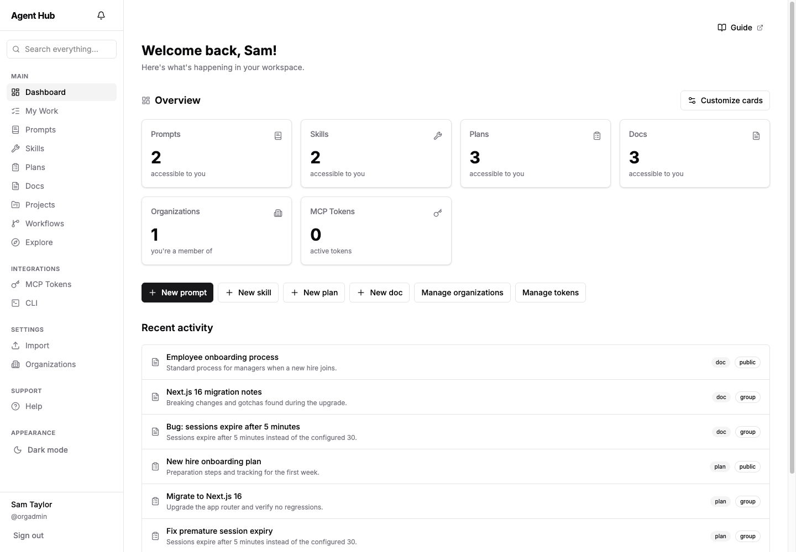
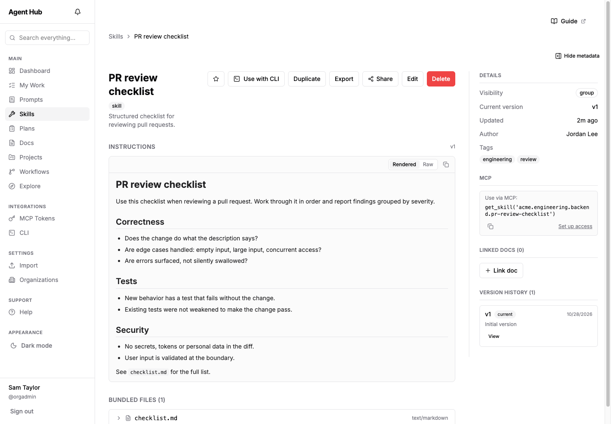
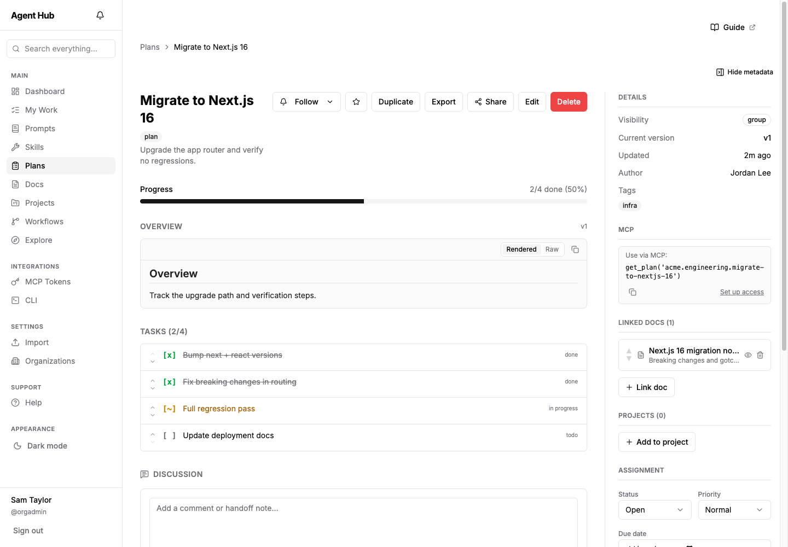
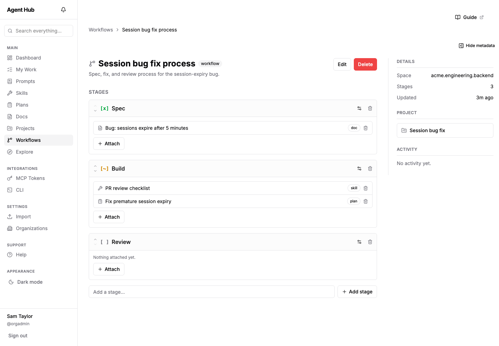

# Agent Hub

[](https://github.com/pxbao-itus/agent-hub/actions/workflows/ci.yml)
[](LICENSE)
[](https://nodejs.org)
[](#running-in-production)

**Store, share, and use reusable building blocks for AI agents** — prompts, skills, plans, and docs — and plug them into your agent over the Model Context Protocol (MCP).

```text
Claude Code · Codex · any MCP client ──MCP over HTTP──▶ Agent Hub ──▶ PostgreSQL + pgvector
```

Instead of copy-pasting prompts and instructions between projects, keep them in one place: versioned, access-controlled across **Organization → Department → Team → User**, searchable, and pulled straight into your agent. No copy-paste, always the latest version.

> **Early-stage project.** It is usable for self-hosting, but APIs and the database schema may still change. See [Running in production](#running-in-production) before you expose it to the internet.

## Screenshots

<table>
  <tr>
    <td width="50%"><br /><sub><b>Dashboard</b> — everything you can access, plus recent activity.</sub></td>
    <td width="50%"><br /><sub><b>Skills</b> — versioned instructions with bundled files and a ready-to-use MCP call.</sub></td>
  </tr>
  <tr>
    <td width="50%"><br /><sub><b>Plans</b> — task lists that agents can read and update, linked to the docs behind them.</sub></td>
    <td width="50%"><br /><sub><b>Workflows</b> — ordered stages with the prompts, skills, plans and docs each one needs.</sub></td>
  </tr>
</table>

## Contents

[Features](#features) · [Quick start](#quick-start) · [Configuration](#configuration) · [Connect an AI agent](#connect-an-ai-agent-via-mcp) · [CLI](#agent-hub-cli) · [Search](#search--embeddings) · [Production](#running-in-production) · [Development](#development) · [Tech stack](#tech-stack) · [Contributing](#contributing)

## Features

- **Reusable building blocks** — *Prompts* (tags, `{{var}}` templates), *Skills* (`SKILL.md` plus bundled files), *Plans* (todo / doing / done tasks that agents can update) and *Docs* (Markdown, linkable to the plans they inform). Every save creates an immutable version with diff and rollback.
- **Collaboration** — assignments and a *My Work* view, ordered *Workflow* stages with artifact references, Markdown discussions with `@mentions`, notifications, a unified activity timeline, and *Projects* for grouping.
- **Search** — full-text (BM25) fused with vector similarity (bge-m3 + pgvector) through Reciprocal Rank Fusion, available as a search page and a `Cmd/Ctrl-K` palette. Semantic search is opt-in; without an embedder it falls back to keyword search.
- **Access control** — an artifact can be owned by a user, team, department, or organization, with permissions that inherit through the hierarchy, plus per-user sharing for one-off grants. Includes an audit log and rate limiting.
- **Agent integration** — an MCP server with scoped tokens (limit by space, tag, read/write, expiry): prompts appear as slash commands, and skills, plans, docs, search, work items and comments are exposed as tools. The `agenthub` CLI installs Skills as native local Skills for Claude Code or Codex.
- **Self-hosting** — Docker Compose with a single Postgres. Credentials login, with Google and GitHub OAuth pluggable through environment variables. Light and dark themes, and a bilingual English/Vietnamese user guide.

## Quick start

Requirements: Docker 24+ with Compose v2.

```bash
git clone https://github.com/pxbao-itus/agent-hub.git
cd agent-hub

cp .env.example .env
# Edit .env:
#   AUTH_SECRET   — generate with: openssl rand -base64 32
#   NEXTAUTH_URL  — the URL you will open the app at (default http://localhost:3000)
#   ROOT_EMAIL / ROOT_USERNAME / ROOT_PASSWORD — the first superadmin account

# Build and start Postgres + the app. The app applies the database schema
# itself on every boot, so there is no separate migration step.
docker compose up -d --build

# Create the superadmin account (first run only; reads ROOT_* from .env)
docker compose exec app npx tsx server/scripts/create-superadmin.ts
```

Open <http://localhost:3000> and sign in. There is no prebuilt image yet; Compose builds one from source.

To update, run `git pull && docker compose up -d --build`.

## Configuration

Everything is configured through environment variables. [`.env.example`](.env.example) lists all of them with comments; these are the ones you will usually touch:

| Variable | Purpose | Default |
| --- | --- | --- |
| `AUTH_SECRET` | Secret used to sign sessions. **Required.** | — |
| `NEXTAUTH_URL` | Public URL of the app, used for the MCP endpoint and auth redirects. | `http://localhost:3000` |
| `DATABASE_URL` | PostgreSQL connection string (the database needs the `vector` extension). Set automatically by Docker Compose. | — |
| `AUTH_TRUST_HOST` | Set to `true` behind a reverse proxy so forwarded headers and client IPs are trusted. | unset |
| `EMBEDDER` | `null`, `local` or `remote`; see [Search & embeddings](#search--embeddings). | `null` |
| `AUTH_GOOGLE_ID` / `AUTH_GOOGLE_SECRET` | Enable Google sign-in. | disabled |
| `AUTH_GITHUB_ID` / `AUTH_GITHUB_SECRET` | Enable GitHub sign-in. | disabled |
| `ROOT_EMAIL` / `ROOT_USERNAME` / `ROOT_PASSWORD` | Credentials for the first superadmin, read once by the bootstrap script. | — |
| `RATE_LIMIT_*` | Per-endpoint rate limits for login, registration and MCP. | see `.env.example` |

## Connect an AI agent via MCP

1. Sign in and open **Settings → MCP Tokens**.
2. Generate a token. It is shown only once, so copy it. A token never exceeds your own access and can be narrowed by space, tag, write capability, or expiry.
3. Add the server to your agent.

**Claude Code**

```bash
export AGENT_HUB_TOKEN="mcp_<your-token>"

claude mcp add --transport http agent-hub http://localhost:3000/api/mcp \
  --header "Authorization: Bearer $AGENT_HUB_TOKEN"
```

By default this registers the server for the current project only; add `--scope user` to make it available everywhere. Run `/mcp` inside Claude Code to check the connection.

**Codex** (Codex Desktop and the CLI share `~/.codex/config.toml`)

```bash
export AGENT_HUB_TOKEN="mcp_<your-token>"

codex mcp add agent-hub \
  --url "http://localhost:3000/api/mcp" \
  --bearer-token-env-var AGENT_HUB_TOKEN

codex mcp list
```

In Codex Desktop you can instead open **Settings → Configuration → Open config.toml** and paste the TOML generated on the MCP Tokens page.

Once connected:

- Your accessible **prompts** show up as slash commands (type `/` in Claude Code).
- **`search_artifacts`** finds prompts, skills, plans and docs by meaning or keyword.
- **`get_skill`**, **`get_plan`** and **`get_doc`** pull a specific artifact; the matching `list_*` tools browse them.
- **`update_task_status`** lets an agent move plan tasks forward.
- **`list_my_work`**, **`set_assigner`**, **`add_assignee`**, **`remove_assignee`** and **`update_work_item`** coordinate Doc/Plan work and Workflow stages, when the token has the required access and write scope.
- **`list_comments`** reads discussions. Write-enabled tokens can also use **`add_comment`**, **`update_comment`**, **`delete_comment`** and **`set_follow_preference`**; comments created this way are marked as MCP activity and follow the same `@username` rules as the UI.

## Agent Hub CLI

MCP fetches instructions on every use. The `agenthub` CLI instead installs Skills as **native local Skills** for Claude Code or Codex, so they load without a round trip. It is a single static Go binary with no dependencies.

```bash
agenthub login https://hub.example.com mcp_<your-token>

agenthub pull skill <slug>                          # Claude: .claude/skills, /agenthub-<short-slug>
agenthub pull skill --all
agenthub pull skill <slug> --target codex           # Codex: .agents/skills, $agenthub-<short-slug>
agenthub pull skill --all --target claude --global  # user-wide: ~/.claude/skills
agenthub clean --dry-run
```

Installs are project-local by default; `--global` manages the separate user-wide collection under `~/.claude/skills` or `~/.agents/skills`. Agent Hub is authoritative for CLI-managed Skills: pull and sync overwrite their local copies and remove managed Skills that disappear from the token's accessible set, while untracked local Skills are never touched.

The macOS builds are an unsigned preview, and no release has been published yet, so for now build from source (Go 1.23+):

```bash
cd cli && go build -o agenthub .
```

See [`cli/README.md`](cli/README.md) for all commands, how to serve downloads from your own instance, and [`cli/RELEASING.md`](cli/RELEASING.md) for the release process.

## Search & embeddings

Semantic search is **opt-in** through the `EMBEDDER` variable, so a minimal self-host stays lightweight:

| `EMBEDDER` | Behavior |
| --- | --- |
| `null` (default) | No embeddings — keyword-only full-text search. |
| `local` | Runs bge-m3 in-process via transformers.js. Downloads ~1–2 GB of model weights on first run (cache with `HF_HOME`). |
| `remote` | Calls a self-hosted HTTP embedding server (HuggingFace Text Embeddings Inference, also bge-m3). Set `EMBEDDER_URL` to its base URL. No local model download. |

When embeddings are enabled, a background reconciler backfills vectors for existing artifacts and search upgrades from keyword-only to hybrid automatically. The model identity is stored alongside each vector, so switching embedders re-indexes cleanly without mixing incompatible vectors. Inspect or clean up stored vectors with `pnpm db:reindex` (list) and `pnpm db:reindex --purge <embedderId>`.

> The embedding column is a fixed `vector(1024)` with an HNSW index, sized for bge-m3. A model with a different dimensionality needs a schema change, not just an environment change.

## Running in production

Agent Hub is early-stage software. If you run it for real users:

- **Use HTTPS** behind a reverse proxy (nginx, Caddy, …). Set `NEXTAUTH_URL` to the public `https://` URL and `AUTH_TRUST_HOST=true`, so sessions and rate limiting see the real client.
- **Change the database password.** `docker-compose.yml` ships a development password (`agenthub`) and binds Postgres to `127.0.0.1` only; keep it that way unless you have a reason not to.
- **Back up the `pgdata` volume.** It holds all your content.
- **Know that schema changes apply on boot.** The container runs `drizzle-kit push --force` on every start, so a change that drops a column also applies automatically, with no confirmation. Read the `schema.ts` diff before you update.
- **Rate limiting is per instance.** The default store is in memory, which is fine for a single instance and resets on restart.
- **Release files are public.** Files in `public/releases/cli` are served without authentication; never put credentials there.

Please report vulnerabilities privately, as described in [SECURITY.md](SECURITY.md).

## Development

Requirements: Node 22+, pnpm 11, Docker.

```bash
pnpm install
cp .env.example .env         # set AUTH_SECRET
docker compose up -d db      # Postgres only
pnpm db:push                 # create tables
pnpm db:seed                 # optional: sample data
pnpm dev                     # http://localhost:3000
```

A `Makefile` wraps the common flows, for example `make setup`, `make test`, `make typecheck` and `make lint`. `schema.ts` is the single source of truth for the database; there is no migration history, and `drizzle-kit push` applies the difference directly.

See [CONTRIBUTING.md](CONTRIBUTING.md) for the full list of checks, how to run the integration tests, and the project layout.

## Tech stack

- **Full-stack**: [Next.js 16](https://nextjs.org) (App Router) + React 19, [tRPC v11](https://trpc.io)
- **Database**: PostgreSQL + [pgvector](https://github.com/pgvector/pgvector) — relational, full-text and vector search in one database
- **ORM**: [Drizzle](https://orm.drizzle.team)
- **Auth**: [Auth.js](https://authjs.dev) (next-auth v5), argon2id password hashing
- **MCP**: the official [Model Context Protocol TypeScript SDK](https://github.com/modelcontextprotocol/typescript-sdk)
- **Embeddings**: pluggable — local [transformers.js](https://huggingface.co/docs/transformers.js) (bge-m3, multilingual) or a remote HTTP embedding server
- **UI**: Tailwind CSS v4, Radix UI, react-markdown, lucide icons
- **Validation**: Zod
- **CLI**: Go, standard library only

One principle: minimal moving parts — TypeScript on top of a single Postgres, self-hosted with one command.

## Documentation

After signing in, open **Help** for the bilingual English–Vietnamese user guide. It covers artifacts, projects, permissions, MCP and administration, and every main screen has a contextual **Guide** link.

## Contributing

Issues, ideas and pull requests are welcome. Read [CONTRIBUTING.md](CONTRIBUTING.md) first, and report security problems privately through [SECURITY.md](SECURITY.md).

## License

Agent Hub is available under the [MIT License](LICENSE).
